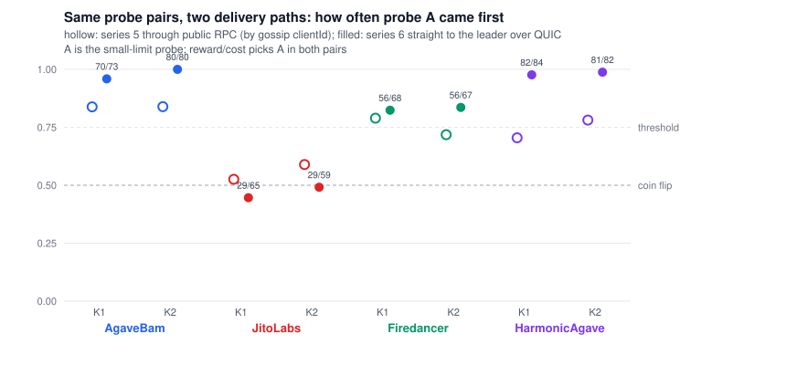

# Inside the Block: how Solana leaders order transactions

We send pairs of our own small transactions into the 4-slot windows of chosen mainnet leaders, then read the produced blocks and check which of the two the leader placed first. Series 1-5 (613 + 800 runs) went through public RPC `sendTransaction`. Series 6 (671 runs, 2026-11-05) sends the same pairs over our own QUIC connection straight to the leader's TPU port, with no RPC in the path. All measurements are after Alpenglow.

**Short answer.** When two transactions reach the leader together, BAM, Harmonic and Firedancer leaders put the one with the higher fee per requested compute unit first (Agave's reward / cost): 150 of 153, 163 of 166 and 112 of 135 runs, over 19-53 leaders per cell. Jito Labs builds show no fee rule on either path (58 of 124 direct, 64 of 115 through RPC). Direct runs show what they do instead: the probe we wrote first on the connection landed first in 91 of 124 runs, which reads as arrival order (exploratory, not pre-registered). Transactions that arrive tens of milliseconds apart keep arrival order at every client (series 1-4). Removing the RPC changed one answer: Firedancer went from "no key" to reward / cost.

| client (gossip `clientId`) | series 5, through public RPC: small probe first | series 6, straight to the leader: small probe first | verdict, series 6 (pre-registered rules) |
|---|---|---|---|
| Agave + BAM (`AgaveBam`) | 88 / 105 (K1), 73 / 87 (K2) | 70 / 73 (K1, 44 leaders), 80 / 80 (K2, 53) | **reward / cost** |
| Agave + Jito, Harmonic build (`HarmonicAgave`) | 31 / 44, 50 / 64 | 82 / 84 (26 leaders), 81 / 82 (31) | **reward / cost** |
| Firedancer (`Firedancer`, `FireBAM`) | 30 / 38, 28 / 39, no key | 56 / 68 (19 leaders), 56 / 67 (23) | **reward / cost** |
| Agave + Jito, Jito Labs build (`JitoLabs`) | 31 / 59, 33 / 56 | 29 / 65 (26 leaders), 29 / 59 (17) | **none**: both cells `undetermined`, near a coin flip |

In both pairs the small probe (600 CU limit) wins under reward / cost and loses under total fee; K2 also sets CU price against reward / cost ([PREREG_SERIES5.md](PREREG_SERIES5.md)). Series 6 has 578 counted runs (both probes in one block of the leader we connected to) over 169 validators and 6 client versions (Agave 4.3.2, 4.4.0, 4.4.0-rc.1; Firedancer 26.10.5, 26.10.6, FireBAM 0.1.1). Series 5 counts here are re-split by `clientId` after the fact ([data/CLIENTID.md](data/CLIENTID.md)); series 6 recorded it at run time. Tables: [data/SERIES6.md](data/SERIES6.md), with one row per validator.



### Check it in one command

```bash
docker compose up
```

No key, no spend. Expected: the unit tests pass, `data/SERIES6.md` is rebuilt from the shipped run files and starts with `Runs 671, counted 578`, 10 random runs are re-fetched from mainnet with `getBlock` and every recorded slot and index matches, then a mainnet dry-run simulates a pair without sending it. Every series 6 signature against the chain: `docker compose run --rm itb python -m itb.verify --runs runs6` (expected `runs 671, blocks fetched 592, probes confirmed 1182, mismatches 0`, as we got on 2026-11-05; 592 `getBlock` calls, so a public archive RPC may rate-limit it, set `VERIFY_RPC_URL` to another one).

### Where each judging point is answered

| criterion | where |
|---|---|
| Design validity | [Series 6 design](#series-6-straight-to-the-leader), [Design](#design-and-how-it-handles-each-point-the-bounty-lists), [What this design does NOT separate](#what-this-design-does-not-separate), pre-registrations [PREREG_SERIES5.md](PREREG_SERIES5.md), [PREREG_SERIES6.md](PREREG_SERIES6.md) (SHA-256 in mainnet Memo before the first counted probe) |
| Verifiability, reproducibility | [Check it in one command](#check-it-in-one-command), [Raw data](#raw-data), `itb/verify.py`, every run file with signatures, slots and UTC times |
| Analysis quality | the table above, [data/SERIES6.md](data/SERIES6.md) (per validator), [REPORT.md](REPORT.md), leader-cluster bootstrap, deviations listed in [Series 6 design](#series-6-straight-to-the-leader) |
| Engineering | [Code map](#code-map), [Safety](#safety-dry-run-keys-spend-cap), 21 unit tests, one spend ledger shared by parallel processes |

## Series 6: straight to the leader

Why: in series 5 the two probes of a pair sat a median 8 transactions apart and mostly landed 3-5 slots after the window opened, so they often did not wait in the leader's queue together. "No rule" and "no key" could describe the RPC path rather than the scheduler. Series 6 asks one question: when the RPC is removed, does the series 5 answer change?

How ([itb/tpu.py](itb/tpu.py), `sender._send_tpu`): for each run we pick the next leader of the target `clientId`, open an unstaked QUIC connection (ALPN `solana-tpu`, self-signed client certificate) to the `tpuQuic` address it advertises in `getClusterNodes` two slots before its window, write both probes back to back on one connection half a slot before the window, in an order set by a coin flip, and re-write the same bytes every 100 ms until 3 slots in. Pairs, prices, CU limits, the shared write-locked account and the analysis rules are the series 5 ones. A run counts only if both probes landed in one block produced by the leader we connected to (stricter than series 5). Counted pairs sat a median 3 transactions apart (280 of 578 within 2), against 8 in series 5.

Deviations from [PREREG_SERIES6.md](PREREG_SERIES6.md), each made because probes did not land, none because of which probe came first:

- **Two pilots, excluded.** The first attempt (07:36-07:49 UTC, 53 runs, 7 of the first 15 counted) and the second (07:50-08:02, 57 runs, 1 of 15) failed the pre-registered 60% gate, so by the file's own rule they are reported as pilots, not analysed. The cause was our clock: the code assumed 0.4 s slots, the cluster ran at 0.21-0.24 s, so probes went out up to 128 slots late and landed with other leaders. The same assumption is the likely reason series 5 probes landed 3-5 slots late. The sender now measures slot length from two RPC reads and keeps one anchor per run (commit `63ab22f`). The counted series started at 08:02 UTC; its first 15 runs had 12 counted. Pilot files: `data/runs6_pilot/`, `data/runs6_pilot2/`.
- **Target selection.** Some ingress addresses (Jito relayer ports, some Harmonic shared ingresses) accept the QUIC streams and never land them. The runner skips a leader after 2 runs with no landed probe (`cli.dead_ingress`). This removes leaders, not runs, and does not look at order.
- **Stop.** The series stopped at 10:26 UTC on the pre-registered spend cap (0.015 SOL for series 6, ledger at 41,699,595 of 41,700,000 lamports), before 200 runs per class and before the 17:00 deadline. Every cell passed MIN_RUNS 40 and MIN_LEADERS 5.
- **Exploratory, not in the plan:** the send-order count for Jito Labs above and the per-validator table.

What series 6 still does not separate: a Jito Labs leader's `tpuQuic` may be a relayer that holds packets before the validator, so "arrival order" may belong to the relayer, not the scheduler; our write order is our clock, not the leader's read order; unstaked QUIC gets the smallest stream budget, so a loaded leader may drop one probe (such runs do not count, 80 of 671); and at a BAM leader we still cannot say which component sorted.

## Series 1-5, through public RPC (as submitted)

**In three lines.** Transactions that reach a leader tens of milliseconds apart land in the order they arrived, whatever the client. Transactions that arrive together are sorted by fee at BAM leaders (13 of 14 BAM leaders lean that way, not one busy validator), and a pre-registered follow-up shows the measure is fee per unit of requested compute, Agave's reward / cost, not the total fee. Firedancer, and Jito-Agave without BAM when both probes touch one account, lean fee-first but do not pass our pre-set threshold; plain Agave has too little data.

### Short answer by client, series 1-5

| client | sent tens of ms apart | sent together: dearer first? (series 4, 0 ms) | which fee measure (series 5) |
|---|---|---|---|
| Agave + BAM | send order kept (11 of 13 blocks) | **yes, `fee`**: 21 of 23 and 25 of 29 runs, 13-14 leaders | **reward / cost**: small probe first in 87 of 104 (K1) and 73 of 87 (K2) |
| Agave + Jito, Jito Labs build | send order kept (17 of 18 blocks, Jito builds together) | not decided: 5 of 6 and 8 of 10 * | **no rule**: 31 of 59 and 33 of 56, close to a coin flip * |
| Agave + Jito, Harmonic build | (counted with the row above) | not decided: 6 of 12 and 12 of 17 * | leans to the small probe: 31 of 44 (K1, not decided), 50 of 64 (K2, passes) * |
| Firedancer (all builds) | send order kept (12 of 12 blocks) | leans fee, not decided: 13 of 17 and 12 of 15 | no key; the result moved with the RPC we sent through |
| Agave, no Jito | too few runs | too few runs | too few runs |

Rows marked * split our Jito class by the `clientId` that `getClusterNodes` reports. We did not record it while measuring; the split uses a snapshot taken on 2026-11-02, after the runs, and is exploratory ([data/CLIENTID.md](data/CLIENTID.md)). All our measurements are after Alpenglow: the last block with on-chain vote transactions is slot 459,652,999 (2026-10-21 13:54 UTC), our first probe landed in slot 460,047,310 (2026-10-22 13:10 UTC); `python -m itb.alpenglow` finds that boundary from `getBlock`.


**Scale, honestly.** Series 1-4 ran on mainnet between 2026-10-22 13:10 and 2026-10-23 03:11 UTC, after the Alpenglow activation on 2026-10-21; we took nothing before the upgrade. 613 runs, 1,498 probes; our probes landed in blocks of 119 different leaders over all series, but the planned test (series 4) aimed at 4 validators, one per class, and the Firedancer and plain-Agave cells rest on few machines (see [data/LEADERS.md](data/LEADERS.md)). Series 5 (2026-11-01, 07:01-20:00 UTC, pre-registered in [PREREG_SERIES5.md](PREREG_SERIES5.md)) asked which fee measure the scheduler sorts by: 800 runs, 627 of them with both probes in one block. Spend reserved under the cap for all five series: 0.0266 SOL of 0.05 ([data/ledger.json](data/ledger.json)).

### Words used below

- **Client class**: the version string plus the Jito flavour. 26.10.x is Firedancer; 4.x is Agave.
- **Jito / BAM / plain**: Agave with Jito's block engine; with Jito's Block Assembly Marketplace, where an outside node assembles the block; or with neither. From Jito's public validator list at measurement time.
- **Probe**: one of our transactions, a 1-lamport transfer. **Dear / cheap**: higher / lower priority fee.
- **Shared account**: both probes of a run credit one account, so both write-lock it and the scheduler must put one after the other.
- **Holm**: a correction for testing several cells at once. **Leader-level**: counting validators, not runs, so one busy validator cannot carry a class.

## The answer in short

- **When our transactions reach a leader tens of milliseconds apart, every client class we measured keeps arrival order.** We sent cheap-first and dear-first in turn; the block followed the send order either way (4.3.2 Jito: 17 of 18 blocks, Firedancer 26.10.4: 12 of 12, 4.3.2 BAM: 11 of 13).
- **When they arrive together, BAM leaders put the higher fee first.** In series 4 (rules fixed before the data, see [ANALYSIS_PLAN.md](ANALYSIS_PLAN.md)) the dear probe came first in 21 of 23 runs with independent accounts and 25 of 29 with a shared write-locked account, across 13-14 different BAM leaders; Holm-corrected p < 0.001. Verdict: `fee`. Counted per leader instead of per run, 13 of 14 and 11 of 13 BAM leaders lean dear-first (exploratory, [data/LEADERS.md](data/LEADERS.md)).
- **Jito-Agave 4.3.2 (no BAM) shows no fee rule we could detect at a 0 ms gap** (9 of 16 independent, 18 of 25 shared account; verdict `undetermined`). With a 150 ms head start the cheap probe stayed first in 13 of 14 runs (`arrival`). That gap equals our re-send period through public RPCs, so we read it as "consistent with arrival order on the RPC path", not as a measurement at the leader's own port.
- **Firedancer 26.10.4 leans towards fee at a 0 ms gap** (13 of 17 and 12 of 15) but does not pass the planned Holm-corrected threshold: `undetermined`. Most of those runs come from one validator (`JUPiTERr`).
- **Plain Agave, 4.3.0, 26.10.3, 26.10.4 BAM and 4.5.0-alpha.2: too few observations to say anything.** We report them as `undetermined`, with counts.
- **Which fee? At BAM leaders, fee per requested compute unit.** Series 5 paired a 600 CU probe against a 60,000 CU one, at prices chosen so that CU price, total fee and Agave's reward / cost disagree. BAM put the small probe first in 87 of 104 runs (K1) and 73 of 87 (K2), over 51-61 leaders, even when it paid 1 lamport of priority fee against 120 and even when it left second. Under the pre-registered rules that reads as reward / cost. The small probe also had the smaller CU limit in both pairs, so a "small requests first" rule fits too. Jito-Agave, Firedancer and plain Agave got no key verdict; for Firedancer the result depended on which RPC carried the pair. Details: [REPORT.md](REPORT.md#series-5-which-fee-measure-does-the-scheduler-sort-by-planned-test-run-2026-11-01).


### Per client class, series 4 at 0 ms gap (the planned test)

| client class | variant | dear first / runs | 95% CI | p (Holm) | leaders | verdict |
|---|---|---|---|---|---|---|
| 4.3.2 bam | independent | 21 / 23 | 0.73-0.98 | 0.0006 | 14 | **fee** |
| 4.3.2 bam | shared account | 25 / 29 | 0.69-0.95 | 0.0008 | 13 | **fee** |
| 4.3.2 jito | independent | 9 / 16 | 0.33-0.77 | 1.0 | 9 | undetermined |
| 4.3.2 jito | shared account | 18 / 25 | 0.52-0.86 | 0.26 | 16 | undetermined |
| 26.10.4 jito (Firedancer) | independent | 13 / 17 | 0.53-0.90 | 0.26 | 4 | undetermined |
| 26.10.4 jito (Firedancer) | shared account | 12 / 15 | 0.55-0.93 | 0.25 | 5 | undetermined |
| 4.3.2 plain | shared account | 3 / 7 | 0.16-0.75 | 1.0 | 2 | undetermined |

At 150 ms, with the cheap probe sent first: 4.3.2 jito kept arrival order in 13 of 14 runs (`arrival`). Every other cell at 150 ms has n < 10.


Per-validator counts for every leader with at least 3 observations: [data/RESULTS.md](data/RESULTS.md). The same data counted per leader: [data/LEADERS.md](data/LEADERS.md).

- Findings: [REPORT.md](REPORT.md)
- Generated tables, with the UTC time of every run: [data/RESULTS.md](data/RESULTS.md)
- Raw data: [data/](#raw-data)

## Run it

```bash
docker compose up
```

This needs no key and spends nothing. It runs the unit tests, rebuilds the result tables from the shipped raw data, re-fetches 10 random runs' blocks from mainnet with `getBlock` to confirm every recorded slot and in-block index, and finishes with a mainnet dry-run: it reads the live leader schedule and client versions, picks the next window of a 4.3.2 leader, then builds, signs and simulates a burst of probes without sending them.

Check every run instead of 10:

```bash
VERIFY_SAMPLE=1000 docker compose up
```

Live sending spends SOL. Put a keypair file (JSON array, as written by `solana-keygen`) in `./secrets/measure.json`, fund it, then:

```bash
docker compose run --rm itb python -m itb.payers fund --n 4 --lamports 3000000 --live
docker compose run --rm itb python -m itb.cli --leader <identity> --order burst --fees 0,100000,1000000,10000000 --payers 4 --live
docker compose run --rm itb python -m itb.analyze data/runs/live_<slot>.json
```

`scripts/series.sh` (series 2-3) and `scripts/series4.sh` (series 4) repeat this over a set of leaders, which is how we collected the data. `python -m itb.payers sweep --live` returns what is left on the payers to the main key.

## Safety: dry-run, keys, spend cap

- Without `--live` nothing reaches the network. The dry-run signs each probe and calls `simulateTransaction`. Without a key it uses a throwaway keypair, so the simulation reports `AccountNotFound`.
- Keys come only from files named by `KEYPAIR_PATH` and `PAYERS_PATH`, mounted from `./secrets` (in `.gitignore` and `.dockerignore`). The repository holds no key.
- `itb/budget.py` keeps a ledger in `data/ledger.json`. Before a probe goes out, the ledger reserves its worst-case fee: 5000 lamports base plus CU limit times CU price. A reservation that would cross `SPEND_CAP_SOL` (default 0.05) raises and stops the run. The reservation happens once per probe, even though we re-send the same signed bytes several times: a signature can land once and pay once. The ledger takes a file lock and re-reads the total on every reservation, so two series running in parallel share one cap. Tests: `tests/test_budget.py`.
- Total reserved for all our measurements: see `data/ledger.json` (the cap is 50,000,000 lamports).

## Design, and how it handles each point the bounty lists

### Leader schedule and leader types

`itb/survey.py` takes `getLeaderSchedule`, `getClusterNodes` (the `version` field) and stake from `getVoteAccounts`. It also pulls Jito's public validator list (`kobe.mainnet.jito.network/api/v1/validators`) for two flags: `running_jito` and `running_bam`. BAM, Jito's Block Assembly Marketplace, has an external node assemble the block, so we treat it as its own fork. A client class is the version string plus that flavour, for example `4.3.2 bam` or `26.10.4 jito` (26.10.x is the Firedancer version line). Every survey is saved in `data/survey_<epoch>.json`, so the class each leader had at measurement time is on record.

We first tried to spot Jito leaders by transfers to Jito tip accounts inside their blocks. That failed: every block we fetched had such transfers, Firedancer blocks included, because anyone can send a plain transfer to a tip account. We dropped the method and kept the note in `itb/survey.py`.

Leaders hold 4 consecutive slots. We aim at the first slot of a window and keep re-sending until 4 slots into it.

### The path from our backend to the executing node

Our probes go to two public RPC endpoints (`SEND_URLS`, default publicnode and api.mainnet-beta). Each endpoint forwards to the current and next leaders over QUIC on its own terms: stake-weighted QoS, its own retry policy, its own view of the schedule. A Jito or BAM leader may add a hop of its own (relayer or BAM node) before the scheduler. We see none of these hops. We see when we sent, and where the transaction landed.

What we do about it:

- We send to two forwarders at once and re-send every ~150 ms. The probe reaches the leader through whichever path is fastest. Duplicates cost nothing: the same signature cannot land twice.
- We cannot sign ahead of time, since a blockhash expires after ~150 slots and the next window may be minutes away. The sender sleeps until 10 slots before the window, takes a fresh blockhash, signs, and starts sending 3 slots before the window.
- The local slot clock interpolates between `getSlot` reads and anchors on the highest slot several endpoints report. One endpoint lagged the cluster by 2-6 slots, once by 50, which made us miss windows before this fix.
- A probe that misses the target window often lands with the next leader. The analysis attributes every block to the leader that produced it (`getSlotLeaders`), never to the one we aimed at.

### Interaction of our own transactions with each other

Each probe is a 1-lamport transfer from a payer to itself, plus `SetComputeUnitLimit(600)` and `SetComputeUnitPrice`. The probes of one run use separate funded payers (`itb/payers.py`), so no two probes write-lock the same account and the scheduler can run them in parallel or in any order. That freedom could hide a fee rule, so series 4 also runs a `contended` variant: both probes transfer to one shared account (`--contended`), both write-lock it, and the scheduler has to put one after the other. The transfer amount is `1 + index`, which keeps signatures distinct. Probes differ only in priority fee, payer and send time. They use the same program and the same compute units (450 consumed), so the cost model gives them the same cost and the fee alone sets their priority.

### Competition inside the block

The 67 blocks of series 1 held 269 to 1,667 transactions. Ours are tiny, so we never compete for block space; we compete for position. We compare our probes only against each other, inside one block. `itb/blocks.py` adds context from everyone else's transactions in those 67 blocks (we did not fetch full blocks for later series): priority per cost unit (fee minus base fee, divided by `meta.costUnits`) against position, as a Spearman correlation. Since mainnet now carries v1 transactions that set the price in a `transactionConfig` field instead of a ComputeBudget instruction, we read what the ledger charged, not the instructions. This is supplementary. The claims rest on our own probes.

### Send order

Two designs, run in turn against the same leaders:

- Sequential (`asc`, `desc`, `random`): probes leave one after another, each to all endpoints before the next. The gap between consecutive probes is one RPC round trip, tens of milliseconds (recorded per probe as `sent_at`). In `asc` the cheapest goes first, so arrival order and fee order point in opposite directions: every pair that lands in one block discriminates between the two rules.
- Burst: all four probes go out in the same instant, to all endpoints in parallel. Arrival order at the leader is then down to network jitter. A leader that ranks by fee puts the dearer one first nearly every time; a leader that does not gives a coin flip.

Fees in the second series: 0, 100,000, 1,000,000 and 10,000,000 micro-lamports per CU, so 0, 60, 600 and 6,000 lamports of priority fee. The first series topped out at 60 lamports, small next to what the block's other transactions pay, so the second series covers the range where a fee-ranking scheduler has a reason to act.

Series 4 tests the gap directly. Each run sends two probes, CU price 0 and 10,000,000. A coin flip (seed from the clock, saved in the run file) picks which leaves first, and the second follows 0, 5, 20, 50 or 150 ms later. The first round goes to every endpoint without waiting for replies, so the gap is the gap we set (each probe's `sent_at` records it). At 0 ms arrival order is down to network jitter, so a systematic winner can only be the fee. At 150 ms with the cheap probe first, fee and arrival disagree. We wrote the decision rules in [ANALYSIS_PLAN.md](ANALYSIS_PLAN.md) and committed them before the first series 4 probe; the git history shows the order. We also had to extend the series after an interim look, because the planned volume could not reach the rules' n >= 10. The plan's addendum says so, and we kept the rules unchanged.

### Noise versus rule

`itb/report.py` counts, per leader and per client class:

- sequential pairs where arrival and fee disagree: how often arrival won, how often fee won, with an exact two-sided sign test;
- sequential pairs where arrival and fee agree: how often the block followed them, how often it broke both (a direct noise measure);
- burst pairs: dearer first versus cheaper first, with the same sign test.

Pairs from one run share a block, so they are not independent. For series 1-3 the tables also count one vote per block (the majority of its pairs), and the conclusions rest on that count. Series 4 sends two probes per run, so a counted run is one independent observation. Its verdicts follow the pre-registered rules: `fee` needs a dear-first share of at least 0.75 with a Holm-corrected sign test p < 0.05; `no fee rule` needs n >= 10 and a 95% interval that holds 0.5 but stays below 0.75; anything else is `undetermined`. "No rule" counts as a valid answer.

## What this design does NOT separate

- Arrival order at the leader. We know our send order, not the order in which packets reached the scheduler. A sequential pair with a fee win can mean the dearer probe overtook, or that the forwarders swapped them in transit.
- The Agave or Firedancer scheduler from the Jito or BAM layer on top of it. We tag leaders by Jito's list, which states intent. A BAM leader's own `bam_connection_rate` is below 1 for some, so a given slot may have been built without BAM.
- Builds that report the same version string. Jito Labs and Harmonic builds of Agave both say 4.3.2 or 4.4.0, and Jito's list does not tell them apart. What we checked after: `getClusterNodes` reports a `clientId`, and a snapshot taken on 2026-11-02 splits the Jito-class leaders we counted in series 5 into 36 Jito Labs and 34 Harmonic. Re-counted that way ([data/CLIENTID.md](data/CLIENTID.md)), Jito Labs sits at a coin flip and Harmonic leans towards the small probe. The snapshot is from after the runs: all 89 leaders Jito's list of 2026-11-01 called BAM are AgaveBam in it, and only 1 leader the list called Jito is, but we cannot prove no one switched build.
- Scheduling batches. If the fee rule holds only among transactions that wait in the buffer together, a probe that arrives into an idle scheduler goes out at once. Series 4 varies the gap in five steps (0-150 ms), but only 0 and 150 ms have enough runs for a verdict, so we cannot place the crossover finer than "between 0 and 150 ms". Our gap is the gap at sending; the forwarders add their own jitter on the way to the leader.
- Slots within a window. We pool the 4 slots of a window, and a probe that arrives later in the window goes to a later slot.
- Validator-specific patches. Two leaders with the same version string can run different scheduler settings. Per-leader rows show this; we do not explain it.

## Raw data

- `data/runs/live_<target_slot>.json`: one file per run. Per probe: signature, payer, CU price, send rank, send time (unix), landed slot, index in that block, block size, producing leader. Per run: target leader, its version and Jito flags, order, blockhash, number of send calls, UTC time (`taken_at_unix`).
- `data/survey_<epoch>.json`: leader schedule with version, stake and Jito flags at measurement time. `data/jito_validators_2026-10-22.json`: the Jito list used to tag the first series.
- `data/blocks/<slot>.json`: every transaction of every block we landed in (signature, fee, cost units, priority per CU, tip and vote flags). `data/blocks_summary.json`: the per-block correlation.
- `data/summary.json`, `data/RESULTS.md`: generated by `python -m itb.report`, offline.
- `data/ledger.json`: lamports reserved under the spend cap.
- `data/collisions.json`: the 9 windows two parallel series both targeted (see REPORT.md, "What went wrong").
- `data/logs/`: the console logs of every series as they ran.
- Series 5: `data/runs5/` (run files, same fields plus `pair`, `target_class` and the CU limit of each probe), `data/survey5/` (its leader surveys), `data/SERIES5.md` and `data/series5_summary.json` (generated by `python -m itb.series5`). `python -m itb.verify --runs runs5` re-checks it against mainnet.
- Series 6: `data/runs6/` (run files, plus `via`, `tpu` with the connection result, `leader_client_id` and per-probe `late_ms` and `slot_sec`), `data/survey6/`, `data/SERIES6.md` and `data/series6_summary.json` (generated by `python -m itb.series6`), the two excluded pilots in `data/runs6_pilot/` and `data/runs6_pilot2/`, console logs in `data/logs/series6_*.log`.
- `data/clientid_2026-11-02.json`: the `getClusterNodes` snapshot (`clientId` and version per node) behind `data/CLIENTID.md`. `data/LANDING.md`: landed / sent per fee.

To check one claim by hand: take a signature and slot from a run file, call `getBlock(slot, {"transactionDetails": "signatures", "maxSupportedTransactionVersion": 1})` on an RPC that keeps old blocks (api.mainnet-beta.solana.com does; publicnode drops them after about ten days), and find the signature's index in the list.

## Code map

| File | What it does |
|---|---|
| `itb/survey.py` | leader schedule, client versions, Jito/BAM flags |
| `itb/sender.py` | probe building, slot clock, timed sending, dry-run simulation |
| `itb/cli.py` | one run against a version or a leader; dry-run unless `--live` |
| `itb/budget.py` | spend-cap ledger |
| `itb/payers.py` | fund, show and sweep the separate fee payers |
| `itb/analyze.py` | landed slot, block index and producing leader per probe |
| `itb/report.py` | pair statistics, `RESULTS.md` |
| `itb/blocks.py` | whole-block context: priority vs position, tip transfers |
| `itb/verify.py` | re-check the raw data against mainnet |
| `scripts/series4.sh` | series 4: gap and shared-account runs |
| `ANALYSIS_PLAN.md` | series 4 decision rules, committed before the series |
| `scripts/series.sh` | the live series as we ran it |
| `itb/series5.py` | series 5 pairs, target classes, planned analysis, `data/SERIES5.md` |
| `itb/figures.py` | leader-level view of series 4 (`data/LEADERS.md`) and the SVG figures in `docs/` |
| `itb/clientid.py` | post-hoc split of series 4 and 5 by gossip `clientId` (`data/CLIENTID.md`) |
| `itb/landing.py` | landing rate against fee (`data/LANDING.md`) |
| `itb/alpenglow.py` | finds the Alpenglow switch from `getBlock` and compares it with our first probe |
| `scripts/series5.sh` | series 5, one process per class |
| `scripts/memo_prereg.py` | writes a file's SHA-256 into a mainnet Memo |
| `PREREG_SERIES5.md` | series 5 decision rules, committed and hashed on chain before the series |
| `itb/tpu.py` | series 6: unstaked QUIC to a leader's `tpuQuic`, one stream per transaction |
| `itb/series6.py` | series 6 counting rule, verdicts, per-validator table, `data/SERIES6.md`, `docs/series6.svg` |
| `scripts/series6.sh` | series 6, one process per `clientId` class |
| `PREREG_SERIES6.md` | series 6 rules, committed and hashed on chain before the first counted probe |

## Changes after submission

The repository as submitted on 2026-11-01 is tagged [`submitted-2026-11-01`](https://github.com/DmitriyTopka/inside-the-block/tree/submitted-2026-11-01). Everything below came later; series 1-4 data, rules and verdicts are unchanged.

- 2026-11-01: `PREREG_SERIES5.md` committed, then its SHA-256 written to mainnet in Memo transaction `4fZJtBxKx9MvTw56QAT81rd5LPWrMS6tnZVrXHJ4p9JDGByhMYuMZuXJ7U1Jc2iYb174VtBcLzYyK7KTGPackgmJ`, before any series 5 code or probe.
- 2026-11-01: the sender takes a CU limit per probe (it was a constant 600), targets a client class, and can send through one RPC picked by coin flip. Series 5 runs go to `data/runs5/` and its leader surveys to `data/survey5/`, so series 1-4 tables do not move when validators upgrade.
- 2026-11-01: leader-level re-count of series 4 and two figures (exploratory). The Jito 150 ms `arrival` verdict is now worded as what the RPC path delivers: it equals our re-send period.
- 2026-11-01: series 5 ran from 07:01 to 20:00 UTC, 800 runs, stopped at the pre-registered run count. Results in [data/SERIES5.md](data/SERIES5.md) and REPORT.md, under the rules exactly as committed. Payers swept back to the main key afterwards.
- 2026-11-02: three checks after the fact, no new spend. A split by gossip `clientId` (snapshot of 2026-11-02, exploratory): the Jito class was two builds, Jito Labs near a coin flip and Harmonic leaning towards the small probe. Landing does not depend on fee (series 1-4: 88% at price 0, 89% at 10,000,000; series 5: both probes landed or neither, in all 800 runs). The Alpenglow boundary found from the chain. A short answer table at the top.
- 2026-11-05: `submission-82f96af` tag marks the repository before the work below. Added the post-hoc checks (`itb/clientid.py`, `itb/landing.py`, `itb/alpenglow.py`).
- 2026-11-05: `PREREG_SERIES6.md` committed (`c751d19`), then its SHA-256 written to mainnet in Memo transaction `2QrFGEkJsxtUsFfTeazQiQmfPhvxErt9G5xi77B9yEiTbW3MjHVkkfALkqEmYmx7y5dAdyF5mkN7ZSwc2AuX143F`, before the first counted series 6 probe.
- 2026-11-05: direct QUIC delivery (`itb/tpu.py`, `--via tpu`, `--target-client`), measured slot length and one clock anchor per run (`63ab22f`), series 6 tables, figure and 4 tests. Series 6 ran 07:36-10:26 UTC: two pilots, then 671 runs, stopped at the spend cap. Series 1-5 data, rules and verdicts are unchanged; the series 1-5 sections below the series 6 one are as before.
