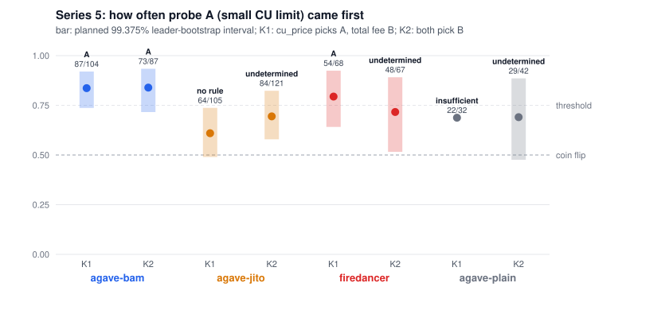

# Report: transaction ordering inside Solana blocks, mainnet, 2026-10-22/23 and 2026-11-01

Series 1-4 ran between 2026-10-22 13:10 and 2026-10-23 03:11 UTC, series 5 on 2026-11-01 between 07:01 and 20:00 UTC, all after the Alpenglow activation (2026-10-21). We took no measurements before the upgrade. [data/RESULTS.md](data/RESULTS.md) lists every run with its UTC time, target leader, client class, send order, fees and the blocks its probes landed in.

## Answer in short

- Probes that reach a leader tens of milliseconds apart land in arrival order, in every client class we measured. This holds whether the cheap or the dear probe goes first.
- Probes that arrive together land fee-first at **BAM** leaders (4.3.2 with Jito's Block Assembly Marketplace): 21 of 23 and 25 of 29 runs, 13-14 different leaders, verdict `fee` under rules we committed before the data.
- **Jito-Agave 4.3.2** without BAM shows no detectable fee rule at a 0 ms gap and keeps arrival order at 150 ms (`arrival`, 13 of 14).
- **Firedancer 26.10.4** leans fee-first at 0 ms (13 of 17, 12 of 15), short of the planned threshold: `undetermined`.
- Plain Agave, 4.3.0, 26.10.3, 26.10.4 BAM and 4.5.0-alpha.2: too few observations, `undetermined`.
- **Series 5** (pre-registered, 800 runs on 2026-11-01): BAM leaders order a write-locked pair the way Agave's priority, reward / cost, orders it. A probe paying 1 lamport of priority fee with a 600 CU limit came first ahead of one paying 120 lamports with a 60,000 CU limit in 73 of 87 runs, over 51 leaders. Jito-Agave, Firedancer and plain Agave got no key verdict.

Every claim below can be checked with `getBlock`: we re-fetched all 785 blocks our 1,328 landed probes sit in, and every signature sits at the recorded slot and index (`python -m itb.verify`, 0 mismatches).

## What we measured

| | count |
|---|---|
| live runs | 613 |
| probes sent / landed / landed in the targeted 4-slot window | 1,498 / 1,328 / 673 |
| leaders whose blocks hold two or more of our probes from one run | 119 |
| client classes (version + Jito flavour) | 9, across 5 version strings |
| SOL reserved under the 0.05 cap (worst-case fees; the real charge is lower) | 0.0113 |

Series, in order:

1. 13:10-15:37 UTC, 30 runs. Targets chosen by version (4.3.2, 26.10.4, 4.3.0), sequential orders `asc`, `desc`, `random`, fees 0 / 1,000 / 10,000 / 100,000 micro-lamports per CU (0 to 60 lamports of priority fee). The first 9 runs predate the slot-clock fix (see below).
2. 2026-10-22 16:16-18:54 UTC, 67 runs, plus the two rare leaders until 22:57. Nine fixed leaders, one per client class: `Fd7btgyS` (4.3.2 jito), `DRpbCBMx` (4.3.2 bam), `7QQGNm3p` (4.3.2 plain), `JUPiTERr` (26.10.4 jito), `9jxgosAf` (26.10.4 bam), `9rkJMARq` (4.3.0 jito), `FBbqKvwL` (26.10.3 jito), `soLStaCk` (4.5.0-alpha.2 jito), `sce3TfT8` (4.5.0-alpha.2 plain). Burst and `asc` in turn, fees 0 / 100,000 / 1,000,000 / 10,000,000 (0 to 6,000 lamports).
3. 2026-10-22 18:50-21:45 UTC, 39 run files. The seven frequent leaders of series 2, burst only, same fees. We added it because series 2 left too few burst blocks per class for a block-level test.
4. 2026-10-22 19:11 to 2026-10-23 03:11 UTC, 477 runs. Two probes per run (CU price 0 and 10,000,000), who-first by coin flip, first-round gap 0/5/20/50/150 ms, independent payers or one shared write-locked account. Four leaders: `Fd7btgyS`, `DRpbCBMx`, `7QQGNm3p`, `JUPiTERr`. Decision rules committed at 19:09 UTC, before the first probe ([ANALYSIS_PLAN.md](ANALYSIS_PLAN.md)); extended at 20:39 UTC with 20 more runs per cell at 0 and 150 ms (the plan's addendum explains why).

## Results

### Series 1-3: one vote per block

A block votes once, by the majority of the pairs of our probes it holds. "One after another" counts blocks where send order and fee order disagreed; "all at once" counts burst blocks.

| client class | one after another: arrival / fee | p | all at once: dear / cheap first | p |
|---|---|---|---|---|
| 4.3.2 jito | 17 / 1 | 0.0001 | 10 / 5 | 0.30 |
| 4.3.2 bam | 11 / 2 | 0.022 | 13 / 2 | 0.0074 |
| 26.10.4 jito | 12 / 0 | 0.0005 | 6 / 5 | 1.0 |
| 26.10.3 jito | 3 / 0 | 0.25 | 4 / 4 | 1.0 |
| 4.3.2 plain | 3 / 0 | 0.25 | 3 / 6 | 0.51 |
| 4.3.0 jito | 2 / 0 | 0.5 | 1 / 2 | 1.0 |
| 26.10.4 bam | 1 / 0 | 1.0 | 1 / 1 | 1.0 |

Sent one after another, the order held in every class with data. In sequential pairs where send order and fee order agreed, the block never broke both (12 such pairs, 0 broken).

### Series 4: the planned test

At a 0 ms gap, who arrives first is a coin flip, so a systematic winner points at the fee.

| client class | variant | dear first / runs | 95% CI | p (Holm) | leaders | verdict |
|---|---|---|---|---|---|---|
| 4.3.2 bam | independent | 21 / 23 | 0.73-0.98 | 0.0006 | 14 | **fee** |
| 4.3.2 bam | shared account | 25 / 29 | 0.69-0.95 | 0.0008 | 13 | **fee** |
| 4.3.2 jito | independent | 9 / 16 | 0.33-0.77 | 1.0 | 9 | undetermined |
| 4.3.2 jito | shared account | 18 / 25 | 0.52-0.86 | 0.26 | 16 | undetermined |
| 26.10.4 jito | independent | 13 / 17 | 0.53-0.90 | 0.26 | 4 | undetermined |
| 26.10.4 jito | shared account | 12 / 15 | 0.55-0.93 | 0.25 | 5 | undetermined |
| 4.3.2 plain | independent | 3 / 8 | 0.14-0.69 | 1.0 | 1 | undetermined |
| 4.3.2 plain | shared account | 3 / 7 | 0.16-0.75 | 1.0 | 2 | undetermined |

At 150 ms with the cheap probe sent first, 4.3.2 jito kept send order in 13 of 14 runs: `arrival`. The other classes have fewer than 10 such runs at 150 ms. The 5, 20 and 50 ms cells hold 1-5 runs each; [data/RESULTS.md](data/RESULTS.md) lists them as exploratory.

Reading it together: BAM leaders sort what arrives together by fee. Give the cheap probe a 150 ms head start and BAM kept send order in 8 of 9 such runs (3 of 4 independent, 5 of 5 shared account), too few for a verdict but in line with series 1-3. Jito-Agave without BAM did not pass the fee threshold even with a shared account, where its two probes could not run in parallel. The shared-account cells for 4.3.2 jito (18 of 25) and Firedancer (12 of 15) lean towards fee; with more runs they may cross the threshold. We do not claim that.

### The same data counted per leader (exploratory, added 2026-11-01)

The series 4 verdicts count runs. Runs from one validator share its configuration, so [data/LEADERS.md](data/LEADERS.md) re-counts the gap-0 runs with the leader as the unit: a bootstrap over leaders and a count of leaders whose own majority went each way.

- BAM holds up: 13 of 14 leaders (independent accounts) and 11 of 13 (shared account) lean dear-first; the leader-bootstrap 95% intervals are 0.79-1.00 and 0.69-1.00.
- Jito-Agave with a shared account leans dear-first in 12 of 16 leaders (interval 0.56-0.88). With independent accounts it is 5 against 4.
- Firedancer's lean comes from 4-6 validators, and one of them (`JUPiTERr`) gave 11-12 of the runs; the leader interval reaches down to 0.33-0.50.
- Plain Agave rests on one or two validators. We cannot say anything about the class.

### Context from the rest of the block

For the 67 blocks of series 1, `itb/blocks.py` ranks every other transaction by priority per cost unit against its position. The Spearman correlation ranged from -0.29 to +0.32, median -0.03. No leader's whole block looks fee-sorted. This fits the scheduler picture above: a fee rule, where it exists, acts within what arrives together, not over a whole slot.

Every block held transfers to Jito tip accounts, Firedancer blocks too, so tips say nothing about the client.

## Series 5: which fee measure does the scheduler sort by? (planned test, run 2026-11-01)

Series 4 could not tell which "fee" BAM leaders sort by, because the dearer probe was dearer by every measure at once. Series 5 separates three candidates: CU price, total fee, and Agave's scheduler priority, reward / cost. The design, the decision rules and the stop rule were committed in [PREREG_SERIES5.md](PREREG_SERIES5.md) before any series 5 code or probe, and the file's SHA-256 sits in a mainnet Memo transaction. Nothing below changes those rules.

Each run sent two probes into one leader window at a 0 ms gap, both crediting one shared account. Probe A asked for 600 CU, probe B for 60,000. A coin flip picked which left first, a second coin flip picked the single RPC the run went through.

| pair | probe A | probe B | CU price picks | total fee picks | reward / cost picks |
|---|---|---|---|---|---|
| K1 | 600 CU at 10,000,000 micro-lamports (6,000 lamports) | 60,000 CU at 200,000 (12,000 lamports) | A | B | A |
| K2 | 600 CU at 1,000 (1 lamport) | 60,000 CU at 2,000 (120 lamports) | B | B | A |

800 runs between 07:01 and 20:00 UTC on 2026-11-01, 200 aimed at each class; 1,514 probes landed, and in 627 runs both probes landed in one block. Only those runs count. A run counts for the leader that produced the block, which is not always the one we aimed at. Tables: [data/SERIES5.md](data/SERIES5.md), generated by `python -m itb.series5`.

| class | pair | A first / counted | share | 99.375% leader-bootstrap interval | leaders | verdict | endpoint Fisher p |
|---|---|---|---|---|---|---|---|
| agave-bam | K1 | 87 / 104 | 0.84 | 0.74-0.92 | 61 | **A** | 0.06 |
| agave-bam | K2 | 73 / 87 | 0.84 | 0.72-0.93 | 51 | **A** | 0.04 |
| agave-jito | K1 | 64 / 105 | 0.61 | 0.49-0.74 | 49 | no rule | 0.69 |
| agave-jito | K2 | 84 / 121 | 0.69 | 0.58-0.82 | 57 | undetermined | 0.23 |
| firedancer | K1 | 54 / 68 | 0.79 | 0.64-0.92 | 29 | **A** | 0.03 |
| firedancer | K2 | 48 / 67 | 0.72 | 0.52-0.89 | 23 | undetermined | 0.00 |
| agave-plain | K1 | 22 / 32 | 0.69 | - | 12 | insufficient | 0.27 |
| agave-plain | K2 | 29 / 42 | 0.69 | 0.48-0.89 | 13 | undetermined | 0.30 |

**BAM: A in both pairs, so the key is reward / cost, not CU price and not total fee.** In K2 the small probe paid 1 lamport of priority fee against 120 and still came first in 73 of 87 runs, over 51 leaders. It is not arrival either: when B left first, A still came first in 48 of 60 runs (K1) and 40 of 52 (K2). Agave 4.3.2, 4.4.0 and 4.4.0-rc.1 BAM leaders all lean the same way (exploratory split in [data/SERIES5.md](data/SERIES5.md)).

**Jito-Agave without BAM: no key.** K1 gives `no rule`, K2 `undetermined`. Both lean towards A, 4.3.2 more than 4.4.0 (41 of 57 and 47 of 64 against 21 of 42 and 31 of 50, exploratory), so the per-version split is the next thing we would test.

**Firedancer: no key.** K1 passes (`A`), K2 does not. The K2 cell depends on the path: through publicnode A came first in 34 of 37 runs, through api.mainnet-beta.solana.com in 14 of 30 (Fisher p < 0.01). K1 shows the same direction (37 of 42 against 17 of 26). We did not plan for this and cannot explain it from our data; one reading is that the two forwarders deliver the pair to Firedancer differently.

**Plain Agave: too few counted runs.** Of 200 runs aimed at plain leaders, 73 counted in plain-Agave blocks; the rest landed with the next leader or did not count.

What the BAM result does and does not say:

- In both pairs A also had the smaller CU limit. A rule like "smaller requested CU first", or any priority that divides by requested cost, gives the same two outcomes. The series separates reward / cost from CU price and total fee; it does not separate it from every cost-based rule.
- We read Agave's formula in its source. A BAM block is assembled by Jito's outside node, whose code we did not read, so "reward / cost" here means "ordered the way Agave's priority orders them", not "computed by that formula".
- The BAM K2 endpoint test gives p = 0.04, uncorrected over 8 cells. Through either RPC A came first in more than 3 of 4 runs (35 of 46 and 38 of 41), so the direction does not depend on the path.

All 1,514 landed series 5 probes were re-checked with `getBlock` in the 886 blocks they sit in: every signature is at the recorded slot and index, 0 mismatches (`python -m itb.verify --runs runs5`).

## What went wrong

- **We missed the window often.** Of 1,328 landed probes, 673 landed inside the 4 targeted slots. About 80 landed before the window (we start sending 3 slots early) and the rest after it, a few up to 12 slots late, mostly with the next leader. The analysis follows each probe to the block it actually landed in, so these probes still count, just for a different leader than we aimed at. Some classes got fewer blocks than planned because of it.
- **A lagging RPC clock.** Our first runs timed the window off one RPC's `getSlot`. Publicnode trailed the cluster by 2 to 6 slots, once by 50, so probes went out after the window had passed. Two runs at 13:10 and 13:12 UTC landed nothing, and two more at 13:23-13:24 recorded zero successful sends. One run at 15:32, after the fix, also recorded zero sends; we did not establish why. We now anchor on the highest slot several endpoints report and interpolate between reads.
- **Expired signatures.** The first version signed the probes before waiting for the window. Windows of a given client can be minutes away, and a blockhash expires after about 150 slots, so the signed probes were dead on arrival. The sender now sleeps until 10 slots before the window and signs then.
- **Fees too small in series 1.** The top fee was 60 lamports, small next to what the other transactions in those blocks pay. An "arrival wins" result at that fee level could mean the scheduler ignores fees, or that our fees were too small to matter. Series 2 and 3 raised the top fee a hundredfold to 6,000 lamports.
- **Counting pairs overstated our confidence.** Four probes in one block give up to six pairs, and those pairs share one block's conditions. Our first tables counted pairs, and one class looked like it put cheaper transactions first, 13 pairs to 5. Those 18 pairs came from 3 blocks. The tables now also count one vote per block, and the conclusions above rest on that count.
- **Jito detection by tips failed.** We planned to identify Jito leaders by transfers to Jito tip accounts inside their blocks. Every block we fetched had such transfers, Firedancer blocks included. We switched to Jito's public validator list.
- **The v1 transaction format broke block parsing.** Mainnet blocks now carry v1 transactions (in one block: 233 v1, 159 v0, 98 legacy). `getBlock` with `maxSupportedTransactionVersion: 0` returns an error for such blocks, and v1 puts the priority fee in a `transactionConfig` field. We moved to version 1 and read the fee the ledger charged.
- **A dry-run bug.** Targeting by version picked the first candidate leader by its first slot, then took that leader's next qualifying window, which could be thousands of slots away (once 8,500). It now takes the earliest qualifying window over all candidates. Live runs in series 2 and 3 targeted one leader each and were not affected.
- **The first three runs (13:10-13:12 UTC) have no send counter.** We added it afterwards. Their probes and landing data are complete.
- **`random` order was not random in series 1.** The shuffle seed was fixed at 0, so all six `random` runs used the same permutation (10,000, 0, 1,000, 100,000). Series 4 takes the seed from the clock and saves it in each run file.
- **The timed first round waited for RPC replies.** In the first series 4 test run the sender waited for both endpoints to answer before re-sending, and managed one round instead of four. We fixed it before the series started; that test run is in the data.
- **We sized series 4 wrong.** The plan required n >= 10 per cell, but 4 repetitions per cell, with about 60% of runs landing both probes in one block, could never get there. We noticed after 134 runs, looked at the interim table, and extended the decisive cells (0 and 150 ms) by 20 runs each. The rules stayed as committed; the addendum to ANALYSIS_PLAN.md records that the decision came after an interim look.
- **Two series hit the same window nine times.** Series 3 and series 4 ran in parallel against some of the same leaders, picked the same next window, and wrote the same run file. The later write survived: 5 series 3 runs and 4 series 4 runs are missing from the data (their fees are in the ledger), and each surviving run shared its window with the lost run's probes. `data/collisions.json` lists them. Dropping the 9 surviving runs does not change any verdict (`data/RESULTS.md`, sensitivity section). Run files now get a unique name when one already exists.
- **Public RPCs drop connections.** A full `getBlock` re-check of 785 blocks failed halfway on a dropped connection. The client now retries transport errors.
- **Plain Agave targets mostly missed.** Series 5 aimed 200 runs at plain-Agave leaders. 73 of them counted in plain blocks, 89 counted with other leaders (36 BAM, 36 Jito, 16 Firedancer, 1 unknown client), and 38 did not land both probes in one block.
- **The forwarding path mattered for Firedancer.** We added the endpoint coin flip to rule the path out. For Firedancer K2 it did the opposite: the result depends on which RPC we used (p < 0.01). We report it as found and give that class no key.
- **The network changed under us.** Between series 4 (2026-10-22/23) and series 5 many leaders moved to Agave 4.4.0 and Firedancer 26.10.5. Series 5 classes pool versions as pre-registered; one counted run landed with a client reporting version 0.1.1 and sits outside every class.

## Limits of these conclusions

- **Leaders are not independent.** Cells rest on 1 to 16 distinct leaders, and a few leaders contribute most runs (`DRpbCBMx` gives 27 of the 52 BAM runs at 0 ms). The per-leader counts in README.md show this. A class verdict says what we saw from those validators.
- **The 150 ms `arrival` verdict and our re-send period are the same number.** After the first round we re-send every probe to both RPCs every ~150 ms. A 150 ms head start for the cheap probe therefore also means it had one more round through the forwarders before the dear one appeared. The verdict says what the RPC path delivers, not what the leader's scheduler does with packets that reach its port 150 ms apart.
- **Send gap is not arrival gap.** Two public RPCs forward our probes to the leader. We set the gap at sending; the forwarders add their own jitter, so a 0 ms gap means "close together", not "simultaneous".
- **Jito and BAM tags come from Jito's list at survey time.** Some BAM leaders report a connection rate below 1, so a given slot may have been built without BAM. We did not check this per slot.
- **We pooled the 4 slots of a window.** A probe that arrives later goes to a later slot; we only compare probes that share a block.
- **Holm-corrected tests over 8 gap-0 cells.** Without the correction, the Firedancer and Jito shared-account cells would pass p < 0.05. We stay with the plan.
- **Series 5 cannot tell reward / cost from "small CU limit first".** Probe A had the smaller limit in both pairs; see the Series 5 section.
- **The plain Agave reference is thin.** Only one targeted validator (`7QQGNm3p`), with windows every few minutes; at gap 0 we have 15 counted runs over both variants, too few for a verdict.
